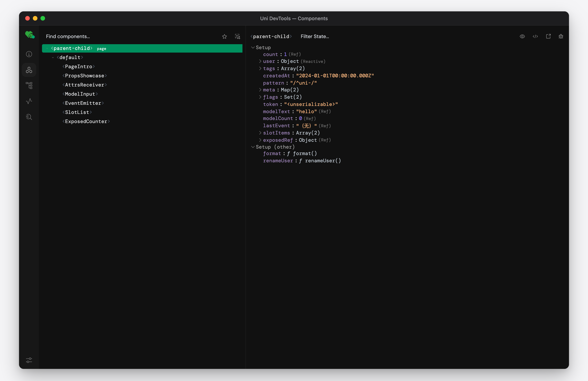
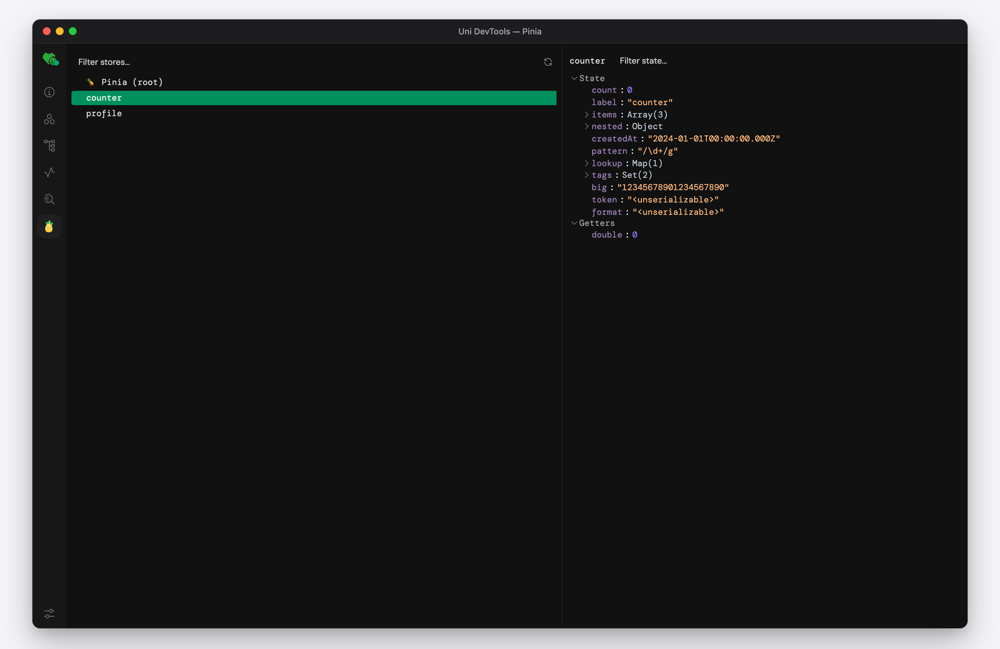
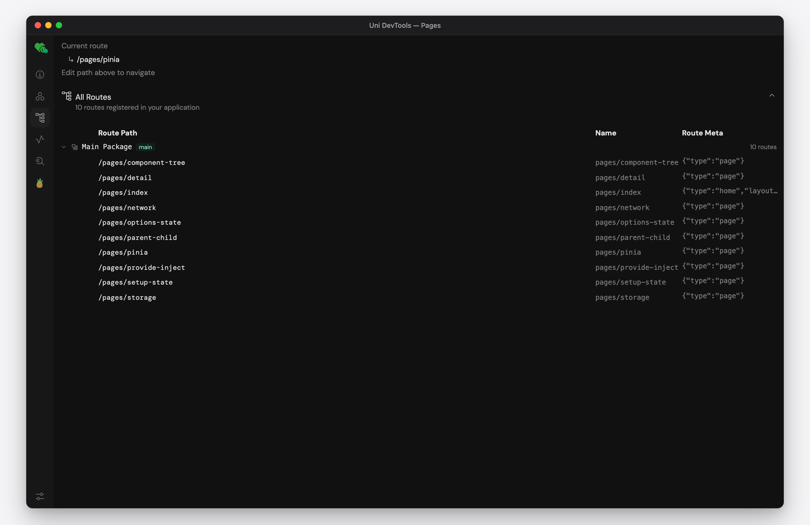

# Uni DevTools

<p align="center">
  <b>为 uni-app（尤其是小程序场景）打造的现代化 DevTools</b><br>
  将官方 Vue DevTools v9 的原生体验与强大能力带入跨端生态。
</p>

<p align="center">
  <a href="./LICENSE"></a>
  
  
  
</p>

<p align="center">
  
</p>

在浏览器里调试 uni-app 小程序：组件树与状态、Pinia / Vuex、页面栈、网络请求、Vite 构建管线，并让 AI Agent 通过 MCP 读取同一份运行时数据。支持 Vue 3 + Vite 与 Vue 2 + Webpack 4 工程。

## 快速上手

### 1. 安装

在 uni-app 项目里安装开发依赖：

```bash
pnpm add -D @uni-helper/devtools
```

只用其中一种构建工具时，也可以只装对应插件包：`@uni-helper/devtools-vite`（Vue 3 + Vite）或 `@uni-helper/devtools-webpack`（Vue 2 + Webpack 4）。

### 2. 注册插件

**Vue 3 + Vite**：在 `vite.config.ts` 里注册 `UniDevtoolsPlugin`，放在 `Uni()` 之前：

```ts
import { defineConfig } from 'vite'
import Uni from '@dcloudio/vite-plugin-uni'
import { UniDevtoolsPlugin } from '@uni-helper/devtools'

export default defineConfig({
  plugins: [UniDevtoolsPlugin(), Uni()],
})
```

**Vue 2 + Webpack 4**：插件只提供 ESM 产物，`vue.config.js`（CommonJS）需要借助 [jiti](https://github.com/unjs/jiti) 加载，先 `pnpm add -D jiti`：

```js
const jiti = require('jiti')(__filename)
const { uniDevtoolsWebpack } = jiti('@uni-helper/devtools')

module.exports = {
  chainWebpack: (config) => {
    return uniDevtoolsWebpack(config)
  },
}
```

插件只在开发模式生效，生产构建不注入任何代码。

### 3. 设置小程序开发者工具

小程序要通过 WebSocket 连本机的 DevTools 服务。以微信开发者工具为例：

1. 菜单栏 `设置` → `安全设置` → 开启 `服务端口`；
2. 项目详情里勾选 `不校验合法域名、web-view（业务域名）、TLS 版本以及 HTTPS 证书`。

### 4. 启动并打开面板

```bash
pnpm dev:mp-weixin    # Vite 工程
pnpm serve:mp-weixin  # Webpack 工程
```

编译启动后，控制台会打印面板地址，用浏览器打开即可：

```text
  Uni DevTools 面板 (浏览器打开):
  http://192.168.1.7:9999/
  探针 WebSocket:            ws://192.168.1.7:9999/__ws
  AI Agent 接入:             npx @uni-helper/devtools connect（推荐）
  MCP（HTTP 直连）:          http://localhost:9999/__mcp
```

地址用的是局域网 IP，真机调试时手机要和电脑在同一网络。

## 功能

| 面板         | 能做什么                                                                                                                                                                             |
| ------------ | ------------------------------------------------------------------------------------------------------------------------------------------------------------------------------------ |
| Components   | 按页面浏览组件树（编译后丢失的组件名会还原成源文件名）；查看和编辑 props / data / setup / computed，包括 `<script setup>` 里的局部变量；查看 render 源码；一键在编辑器里打开组件文件 |
| Pinia / Vuex | 自动发现 Store（不用改业务代码），查看和编辑 State，Vuex 支持命名空间模块与 Getters                                                                                                  |
| Pages        | 列出 `pages.json` 注册的路由（含分包）和当前页面栈；在面板里触发跳转                                                                                                                 |
| Network      | 记录 `uni.request` / `uploadFile` / `downloadFile`（以及直接调用的 `wx.*` 同名 API），瀑布图展示耗时，可查看请求与响应详情                                                           |
| Graph        | 响应式依赖图谱，需要 Vue 3.5 及以上                                                                                                                                                  |
| Inspect      | 查看 Vite 插件管线的转换过程与中间代码（仅 Vite 工程）                                                                                                                               |
| AI Agent     | 上面的数据都能通过 MCP 读写，另外还能读 Storage，见[下文](#ai-agent--mcp)                                                                                                            |

<p align="center">
  
</p>

<p align="center">
  
</p>

各功能的实现原理与限制见 [功能细节](docs/FEATURES.md)。

## AI Agent / MCP

AI Coding Agent（Claude Code、Cursor、Claude Desktop、Windsurf、Antigravity 等）可以通过 MCP 读写面板里的同一份运行时数据：组件树、组件状态（可编辑）、Pinia / Vuex、网络记录、页面栈、Storage。每个工具都带参数 schema 与读写安全标注（如 `clear-network-records` 标为 destructive）。

**推荐：`connect` 网关**。在 MCP 客户端里加一份配置即可，不用写端口：

```json
{
  "mcpServers": {
    "uni-devtools": {
      "command": "npx",
      "args": ["-y", "@uni-helper/devtools", "connect"]
    }
  }
}
```

每个运行中的 dev server 都会登记到本机的实例注册表（`~/.devframe/instances/`），`connect` 从这里找到它们，再把工具调用转发给对应的 dev server。所以端口变了、dev 重启了、同时开着多个项目，都不用改配置。它基于 devframe 的 connect 网关，与 Vue DevTools 等 devframe 工具的接入方式一致。

`connect` 只暴露两个工具，Agent 按这个流程调用：

1. `devframe_connect_list-instances`：列出运行中的实例，每个实例带 `rootDir`、端口和工具列表；
2. 按 `rootDir` 选出要调试的项目（monorepo 里 MCP 客户端的工作目录与 uni 项目不在同一层也没关系）；
3. `devframe_connect_call-tool`：传 `port`、`tool`（如 `uni-helper-devtools_get-component-tree`）和 `args`。参数对象按 devframe 约定放在 `args.arg0` 里，例如 `get-component-state` 传 `{ "arg0": { "id": "<route>#<uid>" } }`。

**可选：HTTP 直连**（Streamable HTTP，仅接受本机请求）。启动日志会打印地址：

```text
http://localhost:<端口>/__mcp
```

地址要用 `localhost`，不要照抄控制台打印的局域网 IP：路由只接受本机进程的请求，经局域网 IP 访问会被拒绝（401）。端口变化时需要手动改配置。

**`mcp` 子命令**：

```bash
npx @uni-helper/devtools mcp
```

它是独立的 stdio 进程，**连不到小程序**，只有源码层面的 `get-registered-routes`（解析 pages.json）与 `get-inspect-status` 能返回真实结果；依赖探针的工具会报错并提示改用 `connect`（网络记录类工具不报错，但只能返回空的或过期的记录）。

## 配置

插件选项（Vite 与 Webpack 相同）：

| 选项   | 默认值                             | 说明                                              |
| ------ | ---------------------------------- | ------------------------------------------------- |
| `port` | `9999`，被占用时自动换一个空闲端口 | DevTools 服务端口。显式指定的端口被占用时启动失败 |
| `host` | 自动选取本机局域网 IP              | 打印的面板地址与注入探针的连接地址所用主机名      |
| `auth` | `false`                            | 开启 token 鉴权，见下文                           |

环境变量：`UNI_DEVTOOLS_PORT`、`UNI_DEVTOOLS_HOST` 与上面的 `port`、`host` 等价，选项优先。

**鉴权**：DevTools 服务默认对局域网开放、不做鉴权（真机调试需要局域网可达）。不希望同一局域网的其他设备访问时，开启 `auth`：

```ts
UniDevtoolsPlugin({ auth: true }) // Webpack：uniDevtoolsWebpack(config, { auth: true })
```

开启后每次启动随机生成 token，打印的面板地址会带上它（`?devframe_auth_token=xxxxxx`）。面板页面本身谁都能打开，但读取调试数据和 inspect 报告需要这个 token。

**在编辑器里打开**：VS Code 用户执行命令 `Shell Command: Install 'code' command in PATH` 即可。其他编辑器设置环境变量 `LAUNCH_EDITOR`，例如 `export LAUNCH_EDITOR=cursor`（WebStorm 为 `webstorm`，Sublime Text 为 `subl`）。

## 注意事项

- **同一时刻只连一台设备**：模拟器和真机（或多台真机）同时在线时，面板与 Agent 只读写最后连上的那台；它断开后回落到仍在线的上一台。
- **node 服务重启后**（开启 `auth` 时）旧的小程序编译产物带的是旧 token，会被拒绝，重新编译小程序即可。

## 参与贡献

欢迎提交 Issue 与 Pull Request。本地开发、仓库结构与测试流程见 [贡献指南](CONTRIBUTING.md)；架构设计见 [架构与核心设计](docs/ARCHITECTURE_PLAIN.md)，更多技术文档在 [docs/](docs/)。

## 赞助

如果你觉得这个项目对你的跨端开发有所帮助，欢迎支持作者持续维护：

<p align="center">
  <a href="https://afdian.com/a/flippedround">
    
  </a>
</p>

---

## License

[MIT](./LICENSE) License © 2024-PRESENT [FliPPeDround](https://github.com/FliPPeDround)
